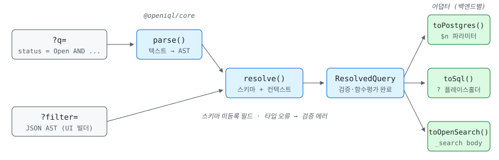
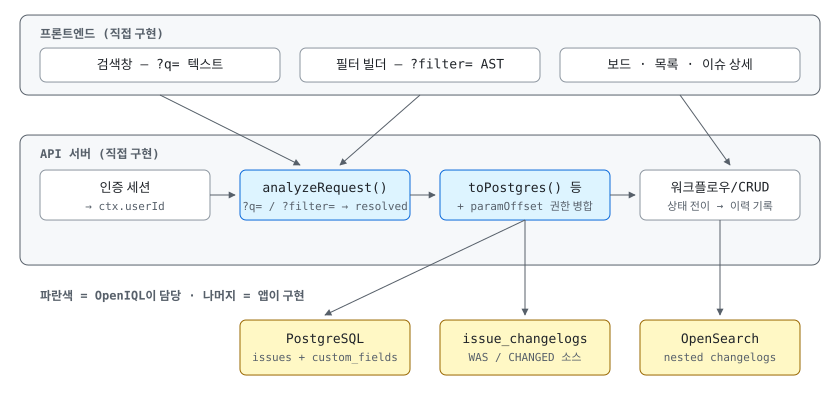

# OpenIQL 사용 매뉴얼

OpenIQL을 이용해 Jira 스타일의 검색 기능을 가진 앱을 만드는 방법을 단계별로 설명합니다.
문법 상세는 [spec/grammar.ebnf](../spec/grammar.ebnf), 함수·옵션 시그니처는 [API.md](API.md)를 참고하세요.



**한 줄 요약**: 사용자의 쿼리 문자열(또는 UI가 만든 JSON 필터) → 검증된 AST → 파라미터화된 SQL/OpenSearch 요청. OpenIQL은 이 변환만 담당하고, DB 실행·인증·권한·UI는 앱이 담당합니다.

---

## 1. 설치

```bash
npm install @openiql/core @openiql/adapter-postgres   # PostgreSQL 사용 시
npm install @openiql/adapter-sql                    # SQLite / MySQL / 범용 SQL
npm install @openiql/adapter-opensearch             # OpenSearch 사용 시
```

`@openiql/core`는 런타임 의존성이 없습니다. 어댑터는 필요한 것만 설치하면 됩니다.

## 2. 스키마 정의

스키마는 "검색 가능한 필드"의 화이트리스트입니다. 여기 등록되지 않은 필드는 쿼리에서 쓸 수 없습니다(인젝션 1차 방어선).

```ts
import { createSchema } from '@openiql/core';

const schema = createSchema({
  fields: {
    // 쿼리 이름 : { 타입, 실제 DB 컬럼/필드명 }
    project:  { type: 'STRING',  column: 'project_key' },
    status:   { type: 'STRING' },                    // column 생략 시 이름 동일
    priority: { type: 'STRING' },
    assignee: { type: 'STRING',  column: 'assignee_id' },
    summary:  { type: 'STRING' },
    created:  { type: 'DATE',    column: 'created_at' },
    points:   { type: 'NUMBER' },
    resolved: { type: 'BOOLEAN' },
  },
  // JSONB/JSON 컬럼 안의 유연 필드 → 쿼리에서 cf.이름 으로 접근
  customFields: {
    story_points: { type: 'NUMBER' },
    team:         { type: 'STRING' },
  },
});
```

- 타입: `STRING | NUMBER | BOOLEAN | DATE`
- 타입별 허용 연산자: `~`/`!~`는 STRING만, `< > <= >=`는 NUMBER·DATE만
- 필드명·컬럼명·커스텀 키는 `^[A-Za-z_]\w*$` 패턴 검증을 통과해야 합니다

## 3. 쿼리 언어 레퍼런스

### 연산자

| 구문 | 의미 | 예시 |
|---|---|---|
| `=` `!=` | 같음/다름 — `!=`는 NULL(값 없는 행)도 포함 | `status = Open` |
| `>` `>=` `<` `<=` | 비교 (NUMBER·DATE만) | `points >= 3` |
| `~` `!~` | 부분 문자열 포함, 대소문자 무시 (STRING만) | `summary ~ login` |
| `IN (...)`, `NOT IN (...)` | 목록 매치 | `status IN (Open, "In Progress")` |
| `IS EMPTY` / `IS NOT EMPTY` | NULL 또는 빈 문자열 | `assignee IS EMPTY` |
| `WAS v` | 과거에 값 v였던 적 있음 | `status WAS "In Progress"` |
| `CHANGED [FROM a] [TO b]` | 상태 전이 이력 | `status CHANGED TO Done` |
| `AND` `OR` `NOT` `( )` | 논리 — 우선순위 `( ) > NOT > AND > OR` | `NOT (a = 1 OR b = 2)` |
| `ORDER BY` | 정렬, 기본 ASC | `ORDER BY priority DESC, created ASC` |

### 값

| 종류 | 형태 | 예시 |
|---|---|---|
| 문자열 | `"..."` `'...'` 또는 따옴표 없는 식별자 | `"In Progress"`, `Open` |
| 숫자 | `-?[0-9]+(.[0-9]+)?` | `3`, `-1.5` |
| 불리언 | `true` `false` | `resolved = true` |
| 날짜 | 문자열로 작성 (ISO 권장) | `created >= "2026-11-20"` |
| 기간 리터럴 | `[+-]?N[smhdw]` — **함수 인자로만** | `-7d`, `+2w` |

키워드(`AND` 등)는 대소문자 무관. 예약어와 겹치는 값은 따옴표로 감싸세요: `status = "Order"` (X `status = Order`).

### 내장 함수

| 함수 | 반환 | 예시 |
|---|---|---|
| `currentUser()` | `ctx.userId` (인증 사용자) | `assignee = currentUser()` |
| `startOfDay(offset?)` | UTC 오늘 00:00 ± offset | `created >= startOfDay(-7d)` |
| `startOfWeek(offset?)` | UTC 이번 주 월요일 00:00 ± offset | `created >= startOfWeek()` |

커스텀 함수를 추가할 수 있습니다(`options.functions`). 함수 호출은 중첩 불가, 인자는 리터럴만 허용됩니다.

### 예제 모음

```text
project = PROJ AND status = Open
assignee = currentUser() AND NOT status = Done
summary ~ "로그인" OR priority IN (High, Critical)
created >= startOfDay(-30d) AND status WAS "In Progress"
cf.story_points > 5 ORDER BY created DESC
assignee IS EMPTY AND project = PROJ
```

## 4. 기본 사용법

```ts
import { analyze } from '@openiql/core';
import { toPostgres } from '@openiql/adapter-postgres';
import pg from 'pg';

const client = new pg.Client(/* ... */);

const { resolved } = analyze(
  'project = PROJ AND assignee = currentUser() ORDER BY created DESC',
  schema,
  {
    context: {
      userId: req.user.id,   // currentUser()가 이 값으로 치환됨
      now: new Date(),        // startOfDay() 등의 기준 시각 (UTC 연산)
    },
  },
);

const { sql, params } = toPostgres(resolved, { tieBreaker: 'id' });
const { rows } = await client.query(sql, params);
```

- `tieBreaker`를 지정하면 정렬 꼬리에 추가돼 페이지네이션이 결정적이 됩니다.
- `context`를 생략하면 `currentUser()` 사용 시 에러, `now`는 호출 시각이 됩니다.

### 에러 처리

```ts
import { OpenIQLError } from '@openiql/core';

try {
  const { resolved } = analyze(userQuery, schema);
} catch (e) {
  if (e instanceof OpenIQLError) {
    // {"error":"SyntaxError","message":"...","location":{"offset":..,"line":..,"column":..}}
    return res.status(400).json(e.toJSON());
  }
  throw e;
}
```

| 에러 | 발생 |
|---|---|
| `IQLSyntaxError` | 문법 오류 — `location`(오프셋/행/열), `expected` 포함 → UI에서 커서 위치에 표시 가능 |
| `UnknownFieldError` | 스키마 미등록 필드 |
| `ValidationError` | 타입 불일치, 함수 인자 오류 |
| `LimitExceededError` | DoS 한도 초과 (§9 참고) |

## 5. 어댑터별 사용법과 DB 준비사항

### PostgreSQL — `toPostgres`

```ts
const { sql, where, orderBy, params } = toPostgres(resolved, {
  table: 'issues',            // 기본값
  customFieldsColumn: 'cf',   // JSONB 컬럼 (기본 'custom_fields')
  changelog: { table: 'issue_changelogs' },   // WAS/CHANGED용
  tieBreaker: 'id',
});
await client.query(sql, params);
```

**필수 테이블** — `WAS`/`CHANGED`를 쓰려면 이력 테이블이 필요합니다(기본 스키마는 [tests/fixtures/schema.sql](../tests/fixtures/schema.sql) 참고):

```sql
CREATE TABLE issue_changelogs (
  id serial PRIMARY KEY,
  issue_id int NOT NULL REFERENCES issues(id),
  field text NOT NULL,          -- 'status' 같은 필드명
  from_value text, to_value text,
  changed_at timestamptz NOT NULL DEFAULT now()
);
```

상태 전이가 일어날 때마다 앱이 한 행씩 INSERT하면 됩니다.

**권한 스코프 병합 패턴** — `paramOffset`으로 앱의 파라미터를 먼저 번호 매기고 OpenIQL 파라미터를 이어 붙입니다:

```ts
const { where, orderBy, params } = toPostgres(resolved, { paramOffset: 1 });
const sql = `SELECT * FROM issues
             WHERE project_key = ANY($1)${where ? ` AND (${where})` : ''} ${orderBy}`;
await client.query(sql, [allowedProjects, ...params]);
```

### 범용 SQL — `toSql` (SQLite / MySQL / ANSI)

```ts
import { toSql } from '@openiql/adapter-sql';

const { sql, params } = toSql(resolved, { dialect: 'mysql', tieBreaker: 'id' });
await conn.execute(sql, params);   // mysql2
```

- `sqlite`: 커스텀 필드는 `json_extract`. Node 22+의 `node:sqlite`로 바로 실행 가능.
- `mysql`: `JSON_UNQUOTE(JSON_EXTRACT)` + `CAST`. DATE 파라미터는 `'YYYY-MM-DD HH:MM:SS'`(UTC)로 자동 변환 — DATETIME 컬럼은 UTC 저장이 전제. 커스텀 필드 컬럼은 `JSON`/`TEXT` 타입.
- `ansi`: 커스텀 필드 미지원(사용 시 에러). ANSI 표준만 쓰는 환경용.

### OpenSearch — `toOpenSearch`

```ts
const { body } = toOpenSearch(resolved, { tieBreaker: 'id', trackTotalHits: true });
await osClient.search({ index: 'issues', body });
```

**인덱스 매핑 요구사항** — 세 가지가 반드시 필요합니다:

1. STRING 필드에 `keyword` 서브필드 (`=`/`IN`/정렬이 `.keyword`로 향하기 때문)
2. `changelogs`는 `nested` 타입 (WAS/CHANGED용)
3. `custom_fields`는 `object` 타입

완성된 매핑 예시는 [tests/opensearch.integration.test.ts](../tests/opensearch.integration.test.ts)의 `MAPPING` 상수를 그대로 복사해 쓰면 됩니다.

`keywordSuffix: ''`로 `.keyword` 접미사를 끌 수 있습니다(인덱스가 이미 keyword 타입이거나 multi-field가 없을 때).

## 6. HTTP 서버 통합 — `?q=` / `?filter=`

`analyzeRequest()`가 텍스트 쿼리와 JSON 필터를 하나의 진입점으로 받습니다.

```ts
import { analyzeRequest } from '@openiql/core';

app.get('/issues', async (req, res) => {
  try {
    const { resolved } = analyzeRequest(
      { q: req.query.q, filter: req.query.filter },   // Express/Fastify 쿼리 파라미터 그대로
      schema,
      { context: { userId: req.user.id, now: new Date() } },
    );
    const { sql, params } = toPostgres(resolved, { tieBreaker: 'id' });
    const { rows } = await client.query(sql, params);
    res.json({ issues: rows });
  } catch (e) {
    if (e instanceof OpenIQLError) return res.status(400).json(e.toJSON());
    throw e;
  }
});
```

- `GET /issues?q=status+WAS+"In+Progress"` → 텍스트 파싱 경로
- `GET /issues?filter={"where":{...},"orderBy":[]}` → JSON AST 경로 (객체 또는 JSON 문자열 모두 허용)
- 둘 다 지정 → `ValidationError`, 둘 다 없음 → 전체 검색(`match_all`/`WHERE 없음`)

## 7. 필터 빌더 UI 연동

`?filter=`가 받는 JSON은 파서의 AST와 같은 구조입니다. UI가 이 객체를 만들어 보내면 되고, `print()`로 텍스트 쿼리로 변환해 검색창에 표시할 수 있습니다(왕복 보장: `parse(print(ast)) ≡ ast`).

```json
{
  "where": {
    "type": "Logical", "operator": "AND",
    "left":  { "type": "Comparison", "field": "status",   "operator": "=", "value": { "kind": "string", "value": "Open" } },
    "right": { "type": "Comparison", "field": "priority", "operator": "=", "value": { "kind": "string", "value": "High" } }
  },
  "orderBy": [{ "field": "created", "direction": "DESC" }]
}
```

노드 타입: `Logical`(AND/OR) · `Not` · `Comparison` · `List`(IN) · `NullCheck`(IS EMPTY) · `History`(WAS/CHANGED). 값은 `{kind:'string'|'number'|'boolean'|'function', ...}`. `span` 필드는 생략해도 됩니다. 서버는 이 JSON을 **신뢰할 수 없는 입력**으로 검증하므로 깊이·리스트 한도가 그대로 적용됩니다.

**저장된 필터**는 AST JSON을 그대로 DB에 저장하고, 불러올 때 `?filter=`로 전달하거나 `print()`로 텍스트로 보여주면 됩니다.

## 8. Jira형 이슈 트래커 제작 레시피



OpenIQL(파란 박스) 외에 앱이 직접 구현할 것:

1. **데이터 모델** — issues(+ custom_fields JSONB), projects, users, comments, issue_changelogs
2. **워크플로우** — 상태 전이 시 `issue_changelogs`에 `{field:'status', from, to}` 기록. 이게 없으면 `WAS`/`CHANGED`가 빈 결과를 반환
3. **인증 → 컨텍스트** — 세션의 user id를 `ctx.userId`로 전달 → `currentUser()` 동작
4. **권한** — §5의 `paramOffset` 패턴으로 "내가 볼 수 있는 프로젝트" 조건을 WHERE에 병합
5. **검색 UI** — 텍스트 검색창(`?q=`)과 필터 빌더(`?filter=`)를 같은 엔드포인트에 연결

백엔드 선택 가이드: 단일 DB로 시작 → `adapter-sql`(sqlite) 또는 `adapter-postgres`. 전문검색(본문 검색, 한글 형태소 등)이 필요해지면 OpenSearch 인덱스를 병행하고 `toOpenSearch`를 사용 — 같은 IQL이 양쪽에서 동작합니다.

## 9. 보안 모델과 한계

**내장 방어**

- 모든 사용자 값은 바인딩 파라미터/쿼리 파라미터 — SQL·DSL에 문자열 결합되는 사용자 입력 없음
- 식별자(테이블/컬럼/필드 경로)는 신뢰된 스키마·옵션에서만 유래 + 패턴 검증
- DoS 한도: 쿼리 2,048바이트, 괄호 깊이 10, `IN` 목록 100, ORDER BY 10개, JSON AST 깊이 1,000 (`options.limits`로 조정 가능)
- `?filter=` JSON도 스키마 검증을 통과해야 함 — 임의 필드/연산자 주입 불가

**앱이 책임질 것**

- `select`, `table` 등 어댑터 옵션에 사용자 입력을 넣지 말 것(신뢰된 문자열만)
- 결과 행 자체의 권한 필터링(§5 패턴) — OpenIQL은 쿼리만 만들고 "누가 볼 수 있는가"는 모름
- Rate limiting, 인증, 감사 로깅

## 10. FAQ

**Q. `status = Open`에서 Open에 따옴표가 왜 없어도 되나요?**
따옴표 없는 식별자는 문자열 값으로 취급됩니다. 다만 예약어(`Order`, `From`, `In` 등 — 대소문자 무관)나 공백·특수문자가 포함된 값은 반드시 따옴표로 감싸세요.

**Q. `!=`가 NULL인 행도 반환하는데 의도된 건가요?**
네 — `priority != High`는 "High가 아닌 것" 의미로, 우선순위 미설정(NULL) 이슈를 포함합니다. JQL의 동작과 동일하게 설계됐습니다. 제외하려면 `priority != High AND priority IS NOT EMPTY`.

**Q. `WAS`/`CHANGED`가 항상 빈 결과를 반환해요.**
이력 테이블(`issue_changelogs` / nested `changelogs`)에 데이터가 없는 것입니다. 이 테이블은 앱이 상태 전이 시점에 기록해야 합니다 — OpenIQL은 조회만 합니다.

**Q. 대소문자 구분은?**
키워드·필드명은 무관. **값은 DB collation에 따라 다릅니다** — Postgres의 `=`는 대소문자 구분, MySQL 기본 collation은 무시. `~`는 모든 어댑터에서 대소문자 무시가 보장됩니다.

**Q. 페이지네이션은?**
엔진이 LIMIT/OFFSET을 만들지 않습니다 — `toPostgres`가 반환한 `sql`에 앱이 `LIMIT $n OFFSET $m`을 붙이거나, `tieBreaker`와 커서 조건(`id > ?`)을 조합하세요.

**Q. 조인/관계 필드(`issue.parent.project` 같은)는?**
필드 경로는 최대 1단계(`cf.key`)입니다. 더 깊은 모델은 뷰/서브쿼리로 평탄화한 뒤 스키마에 매핑하세요.

---

검증 환경: PostgreSQL 16 · MariaDB 11(MySQL 방언) · OpenSearch 2 · `node:sqlite` — 실DB 통합 테스트 136개가 CI에서 실행됩니다(Docker 없으면 자동 스킵).
